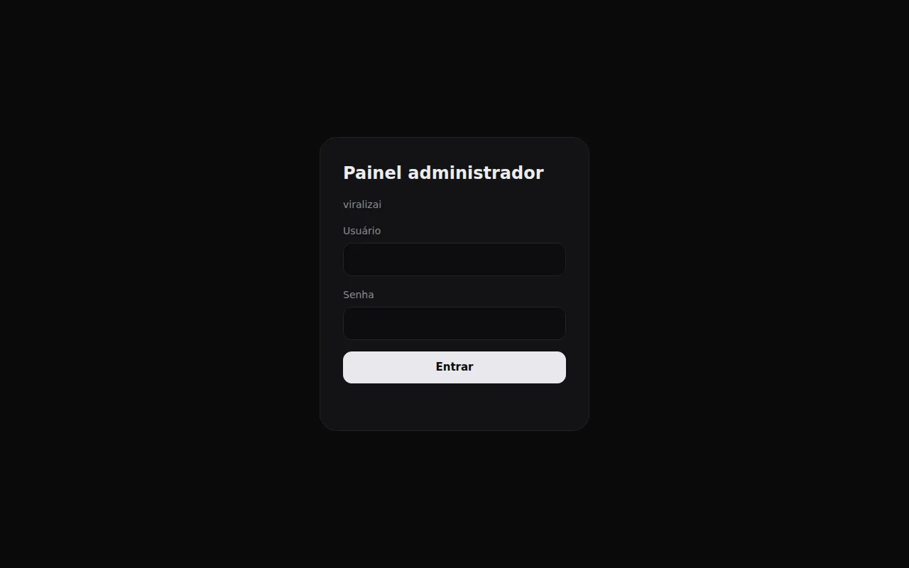

<!-- readme-padrao -->
# Viralizaí

> Viralizaí (Rangel Tech, colab Fael): app de ganhar dinheiro com vídeo curto — cortes de live/vídeo com legenda PT sincronizada, animação 'Desenho animado' programada, vídeo com IA, editor, postar sozinho no TikTok/Instagram e Caçador. Cobre repo, domínios, deploy, segredos, contas (Fael, demo, testes), planos, motor de cortes, pós-produção, animação v3, login nas redes, landing, ícone, regeneração de cortes, QA e armadilhas. Use para qualquer pergunta ou mudança no Viralizaí, nos cortes, nas animações ou nas landings do Fael.


## O que é
Viralizaí (Rangel Tech, colab Fael): app de ganhar dinheiro com vídeo curto — cortes de live/vídeo com legenda PT sincronizada, animação 'Desenho animado' programada, vídeo com IA, editor, postar sozinho no TikTok/Instagram e Caçador. Cobre repo, domínios, deploy, segredos, contas (Fael, demo, testes), planos, motor de cortes, pós-produção, animação v3, login nas redes, landing, ícone, regeneração de cortes, QA e armadilhas. Use para qualquer pergunta ou mudança no Viralizaí, nos cortes, nas animações ou nas landings do Fael.

Estado: **no ar**. Produto da Rangel Tech, vendido pela Cakto (conta do Lucas e conta do Adriano). Registro único dos produtos: `vps_rt_infra/registro/produtos.yml` (spec 57).

## Onde está no ar
- https://viralizai.rangeltech.net
- https://viralizai.fael.rangeltech.net

**Painel do administrador:** `https://viralizai.rangeltech.net/admin` (login único dos produtos; a credencial está no Infisical, `rt-produtos/_admin`).



O usuário de teste (QA) de cada produto é obtido no painel único (`painel.rangeltech.net`, aba do produto).

## Onde faz o deploy
Este repositório **só publica** o artefato; **quem implanta é o `vps_rt_infra`** (nenhum container é trocado à mão).

1. Publicar a release: criar a tag (`v*`); o workflow `.github/workflows/release.yml` gera a imagem e o `release-manifest.json` e publica como release.
2. Implantar (de madrugada, 00h às 06h de Brasília): `gh workflow run deploy.yml --repo RangelTech/vps_rt_infra -f service=viralizai`
   - Só validar, sem implantar: acrescentar `-f dry_run=true`.
3. Voltar uma versão (rollback): `gh workflow run deploy.yml --repo RangelTech/vps_rt_infra -f service=viralizai -f version=<tag-antiga>`.

O serviço no mapa de releases é `viralizai` (`vps_rt_infra/releases/sources.json`).

## Como funciona por dentro
- **API e site:** FastAPI (Python) em `app/`, com a landing em `static/`. Container único (`Dockerfile`).
- **Dados:** hoje SQLite no volume do container; **está planejada a migração** para o banco `produtos` do Postgres (um schema por produto) e dos arquivos para o MinIO (spec 57, seções 8 e 8.6).
- **IA:** fala com o Qwen pelo `llm-access` (chave por produto).
- **Cobrança:** webhook da Cakto (`/api/cakto` ou rota equivalente) libera o plano; a conciliação diária compara pedidos e assinaturas.
- **Login:** hoje por código no e-mail; passa para e-mail e senha com captcha invisível e "entrar por link" (spec 57, seção 5A).

## Segredos
Só os **nomes** das variáveis estão neste repositório, em [`segredos.yml`](segredos.yml). Os **valores** ficam no Infisical (projeto `rt-produtos`, ambiente `prod`, pasta `viralizai`) e chegam à VPS **gerados no momento do deploy**. Nunca coloque valor de segredo no git.

## Rodar e testar localmente
```bash
python -m venv .venv && source .venv/bin/activate   # no Windows: .venv\Scripts\activate
pip install -r requirements.txt
pytest
```
Os testes de QA em produção são por cliques reais (relatório em PDF no `new_ragente/qa/evidencias`).

## Links
- Painel único: https://painel.rangeltech.net (aba do produto: links, usuário de QA, planos)
- Spec de organização geral: `new_ragente/specs/57_ORGANIZACAO_GERAL_PRODUTOS_E_PAINEL.md`
- Monitor: Uptime Kuma, `viralizai`

## Notas técnicas (README anterior)

# Viralizaí

App da Rangel Tech para ganhar dinheiro com vídeo curto (spec 47 em `new_ragente/specs/47*`):

- **Cortar live ou vídeo** — motor em `app/motor/`: sinais sem baixar o vídeo (legenda json3, chat, "mais repetidos",
  comentários com tempo, áudio com YAMNet em CPU), candidatos com a história inteira, 1 juiz de IA, trecho baixado por
  índice DASH (segundos, não minutos). Cache absoluto por vídeo = vitrine "Prontos pra postar".
- **Criar animação** — moldes feitos à mão em `motion/` (Remotion); a IA só preenche um JSON validado (`app/animacao_v2.py`).
- **Vídeo com IA** — moedas, prévia grátis em imagem, gerado pelo Estúdio do llm-access (`app/video_ia.py`).
- **Editar meu vídeo** — legenda automática (Whisper em CPU), gancho, @, velocidade, esticar pra 1 min (`app/editor.py`).
- Fila justa (`app/fila.py`): todo mundo recebe o 1º corte antes de alguém receber o 3º.

Teste local: `VIRALIZAI_DEV=1 VIRALIZAI_DADOS=./dados_local uvicorn app.main:app` e `python -m pytest -q`.
Deploy: somente pelo `RangelTech/vps_rt_infra` (stack `viralizai`). Release: workflow `Release` com a versão.
Segredos: `/opt/platform/secrets/viralizai.env` na VPS (cofre: `personal-skills/secrets/viralizai.env`).
